# cmux Agents sidebar

**Run ten coding agents and still know which one waits for you.**

A right-sidebar panel for [cmux](https://github.com/manaflow-ai/cmux) that puts every agent session of every workspace in one list: who waits for you, who works, who is idle, what each one costs, and how much of each limit is left. One click takes you to the session.

It works with Claude Code, Codex, OpenCode, Grok Build, Antigravity, and any other terminal agent that cmux detects.

| You want to know | The panel shows |
|---|---|
| Which session needs my answer? | An orange dot and a `→ you` pill, and a `NEEDS YOU` block at the top for a session that is blocked on a permission |
| What did each one do last? | The session title and its next step, in two lines per session |
| Is a context window nearly full? | Context share per session, and a menu item that sends `/compact` to an idle session |
| What does this cost? | Cost per session, per workspace and per account |
| Will I hit a limit? | One line per tool and account with the share used and the reset time, and a warning at 80% |
| Where is my lead session? | `Pin to top` keeps it in a block above all groups |
| How do I start one more? | Right-click a workspace: one item per agent tool found on your Mac, per account |

**Local only.** No script calls the network, reads a login token, or stores the text of a message. See [Privacy and safety](#privacy-and-safety).

**Install in three steps:** clone, `bash install.sh`, start the watcher in a cmux tab. See [Install](#install). `bash uninstall.sh` removes it.


A drawing of a cmux window with the panel, with sample names.

The panel opens a page of ten views of the same sessions. Four of them:

| | |
|---|---|
| [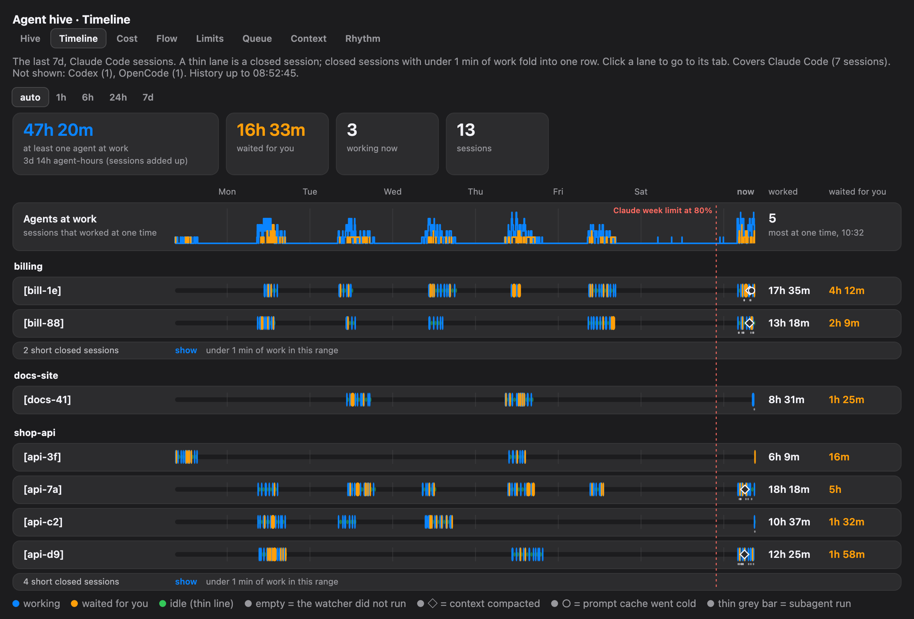](#the-views-page) | [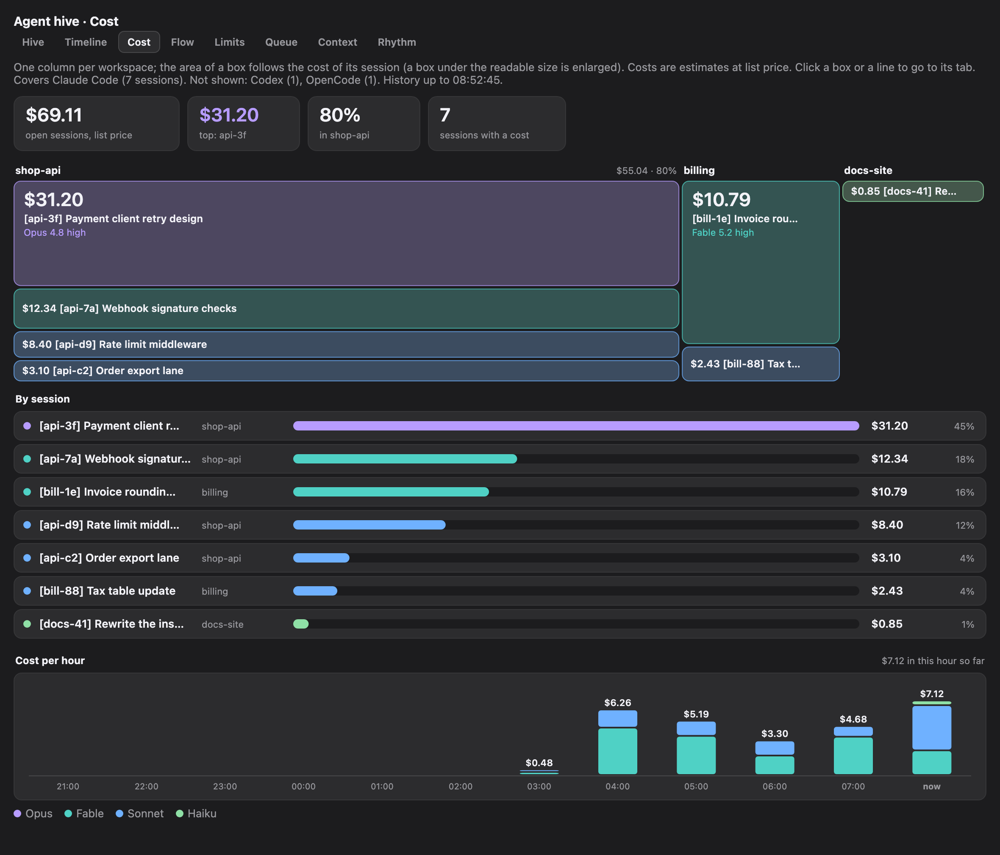](#the-views-page) |
| **Timeline**: who worked, who waited for you, and when | **Cost**: where the money goes, by workspace, session and hour |
| [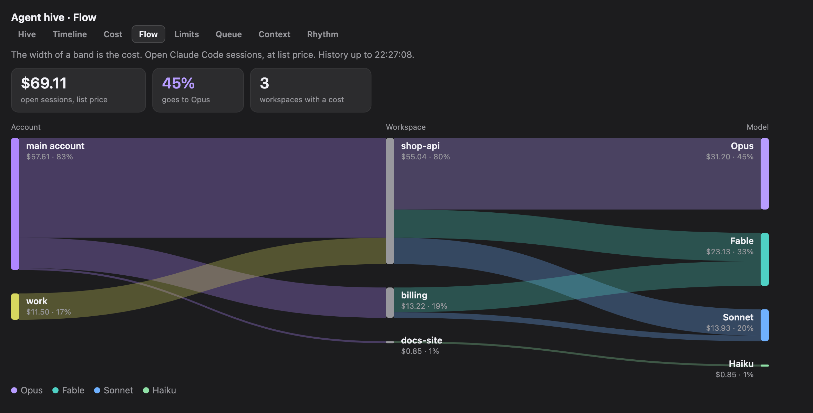](#the-views-page) | [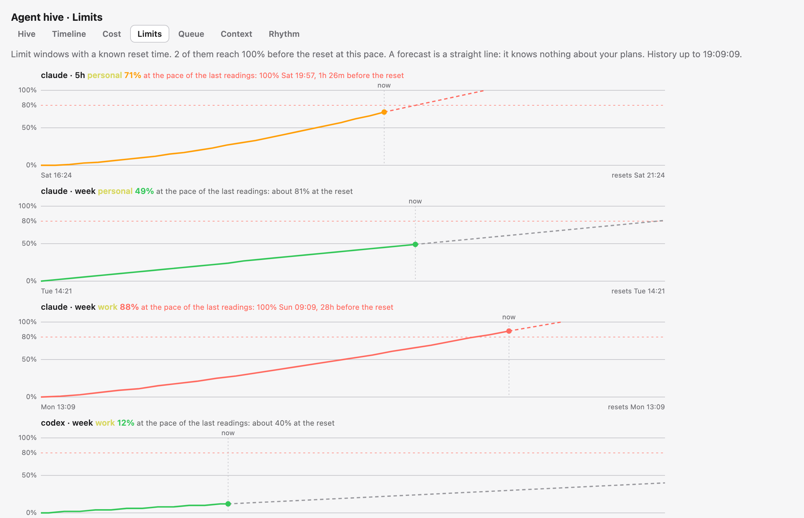](#the-views-page) |
| **Flow**: cost from account to workspace to model | **Limits**: will a limit window reach 100% before its reset? |

All pictures in this file are renders with sample names and sample figures.

## What you get

| Part | What it shows |
|------|---------------|
| One band per workspace | Project folder, colour bar, agent count, summed session cost, unread count. A click opens the workspace |
| One row per session | Status dot, `[name]`, title, time since the last activity; under them the marks, the next step or your request, then model, context share and cost. A click goes to the tab. With an accounts file a pill names the account (`work`) in its colour, and search matches it |
| `NEEDS YOU` block | All sessions that wait for your input, at the top, with the reason when it is known |
| Filter chips | `80%` context nearly full, `PR` has a pull request, `1h+` idle for an hour, `you` the next step is yours, `push` commits that no remote holds. Each chip shows its count and names its filter on hover |
| Head counts | `1 need you` and `2 working` at the top filter the list to those sessions; a second tap shows all. The `idle` count has no tap, because the `1h+` chip counts only sessions idle for an hour |
| `✕ Reset` | Shows when the view is not the default. Back to the default view: no chip, no account, all workspaces, no ended rows, no `By state` grouping. The search text stays |
| Subagents | `▸ 2 sub` on a row opens the subagent rows. The count comes from cmux, or from the Claude Code records when cmux reports none |
| Details | `›` on a row opens state, tool, folder, branch, ports, first and last request |
| Right-click menu | On a session row: `Pin to top` or `Unpin`, copy name, copy folder, copy the PR number (only when the session has a PR), show details, `Show in views` (Hive, Timeline, Inside, Setup), `Open config` (see "The start menu"), fast commands. A plain click on the row goes to the session, so the menu has no item for that |
| Pin a session | Right-click a row → `Pin to top`. The session moves into a `PINNED` block at the top of the list and leaves its group, so it stays in view while that group is folded. `Unpin` puts it back. The pin is kept by session name in the description of its workspace (`@pin: name`), so it survives a reload; a session that gets a new name loses its pin. Only a session with a name can be pinned. `By state` does not show the block |
| `views ↗` | A page of pictures in a cmux browser tab, with a switch at the top: Hive, Timeline, Cost, Limits, Queue, Context, Inside, Rhythm, Setup (see "The views page"). The Hive view is a graph: workspace → session → subagent. It updates every 15 seconds. The open tab has a blue box. A click on a session goes to its tab, and the page follows you to another workspace |
| Next waiting | `next-waiting.sh` goes to the Claude Code session that has waited for you the longest |
| `Limits` | Next to `Sessions` in the first row: the rate limits of each agent tool on this Mac, per window (5 hours, week), with the reset time and the age of the figure. Grouped `by account`; `by tool` groups them per tool (see "The Limits view"). The panel remembers the choice |
| Search | Type in `Search agents`: rows stay when the text is in the tab title (with the session name), the tool, the account, the workspace name or the folder. Capital letters do not matter. A search text looks in every workspace, also with `Here` on. A chip narrows the result further. While `Limits` is on, a search text shows the sessions again |
| Fold all groups | The mark at the right of the search field: `▾▾` folds every listed group, `▸▸` opens them. With some groups open it folds. A search looks inside folded groups; the folds come back when the search text is cleared |
| Account chips | With sessions on two accounts or more, one chip per account under the filter chips, with its row count. A click shows only that account; a second click, or `✕ Reset`, shows all |
| Account colour | Each account name has one fixed colour, the same on the row tag, on the hive page and at the start of the session's status line. There are six colours, so two names can share one |
| Wrong-account mark | `≠ work` in orange on a row: the folder rules name `work` for that folder, and the session runs on another account. Needs `rule` lines |
| Limit warning | One cmux notification when a limit window of any account passes 80% |
| Next step | If the last reply of a Claude Code session ends with a line `Next: ...`, the row details show it. `→ you` in blue on the row when that line starts with `you` or `owner` |
| New tab or new session | Click a workspace header's `+` for a plain terminal tab. Right-click the header for the start menu (see "The start menu"): `Terminal` first, then one item per tool found on your Mac. A tool with 2 or more accounts is a submenu (`Claude` → `personal ★ default`, `work`), with the tool's normal folder first and marked `★ default`. A tool with one account is one item. `Add account` is a submenu: `Claude…` asks for a name in a new tab and makes the account folder. The list comes from your installed tools and your accounts file, so it has no fixed names |
| Asked or finished | A session that waits for your answer has an orange outline, shows `asked` and why it waits in orange on its second line, and also shows at the top of the panel. A session that ended its turn while you looked elsewhere has a purple fill and shows `finished · not seen`. The `✓` chip filters the finished ones |
| Last prompt | The start of your last request to a Claude Code session, in the row details and in the search |
| State from the screen | Codex, OpenCode, Grok and Antigravity tabs publish no state. The row says `working · from screen` or `asked · from screen`, read from the last 12 lines with text of the tab's last 30 lines, so words quoted in older output do not count |
| Compact layout | The name of a session keeps the room: marks are short (`❄190K` cold cache, `83%` context, `▸2/11` subagents running of total) and never cut. Chips with no matching row are left out. The panel head counts states in words: orange needs you, blue working, green idle |
| Groups | A workspace band is tinted in the workspace colour and carries its name in that colour. Its sessions sit 12 pt inside it, and subagent rows one step further. A thin line in the workspace colour runs down the left of its rows, and the status dot of each session sits on that line, so the two marks share one narrow column. A workspace with no session is a flat line in its own colour. A settled session row is flat too: only the focused row, a row that asks and a row that finished unseen have a fill. A dark workspace colour is lightened so it shows on a dark panel |
| Row | Every session takes the same two lines, whatever its state, so the list does not jump when a session starts or ends a turn. Line 1: `[name]`, the title, the subagent count and the time. The name and title are 11.5 pt: the system monospaced font is wider than a terminal font, so this reads as 12 pt terminal text. Line 2: at most 2 pills of at most 10 characters and a `+N` pill that names the rest on hover (a row must never be wider than the panel), then why it waits, the next step (after a `next` label) or your last request. Line 2 ends with the model in lavender (the tool when no model is known) and two columns that line up down the list: the context share in slate blue (yellow from 50%) and the cost in sand. The token count is in the row details, so the next step has the width. The time stays grey, and orange for a session that waits |
| Title | `[name]` then the title of the tab. A tab with no title of its own shows the title of its session in Claude Code: the one you set with `/rename`, else the one the tool gave it |
| Limits | One group per account: the account name once as a small header, then each tool with its windows (5 hours and week on separate lines, the tool name once): bar, percent, window and reset time; the age shows on hover. The tools of that account with no data share one muted `no data` line, and the cost of the account ends its group. Tools with no account name come last, under `other`. With one account and no accounts file there is no header. The `tools` switch (where `state` sits in the other views) groups by tool instead. The strip of the session list shows one limit line per tool that reports a live window (`claude`, `codex`, …): the highest window of that tool over all its accounts, with the account, the window and the reset time |
| Focus and hover | The session of the focused tab has a fill and a thin outline. A row under the pointer has a faint fill only |
| Request | The last request that you typed, with `…` when it is cut, on the second line of a session that works. A notice that the tool added (a text that starts with `<`) is never shown as a request |
| Cards and pills | Each session is a rounded card: orange tint when it is blocked on your answer, a light purple tint when it finished and you did not look. A session that ended its turn with a step for you has an orange dot and no tint. Its marks are small coloured pills under the name, by priority: the wrong-account mark `≠ work`, a PR that needs you, `83%`, `→ you`, `↑2`, `dup`, `⟳3`, `❄190K`, PR, account, folder. A row shows the first 2; `+N` names the rest on hover, and the row details list all of them. The tool has no pill: the model column names it |
| Stalled | A session with no output for 20 minutes shows `quiet 20m+` in orange on its second line |
| Health | One mark per row, the worst first: `loop 6` (red: 6 failed tool calls in a row), `overlap 2` (yellow: 2 files also edited by another session), `silent 1` (yellow: a subagent with no output for 10 minutes to 2 hours). The row details list all of them, with the total of failed tool calls and API errors; that total is not a mark, because every long session has one |
| On its agents | A session that ended its turn while its subagents still run shows `agents running` and is not counted in `NEEDS YOU` until they end. A permission or a question always counts |
| Not seen | A session that ended its turn in a tab without focus is `finished · not seen` until you open the tab (kept until the panel reloads) |
| `By state` | In row 1, between `Sessions` and `Limits`: groups the rows by state in place of by workspace: `NEEDS YOU`, `FINISHED · NOT SEEN`, `RUNNING`, `RECENT` (idle under 1 hour), `IDLE`. Each row then carries its workspace as a pill. Not saved across reloads |
| Limit bars | Each live limit window has a bar and its percent in fixed columns: green, orange from 50%, red from 80%. Each limit line of the strip has a small bar too. The `train` line leaves out clauses such as `refused none` |
| Empty list | `No sessions yet` when no session runs. `Nothing matches` when a chip, an account, `Here` or the search hides every session; `Clear filters` resets the view and the search |
| Work marks | In orange on a row: `dup` when two live sessions work in one folder on one work branch, `↑2` for 2 commits that no remote holds, `⟳3` from the third context compaction |
| Cost per account | In `Limits`, at the end of the group of each account (in the per-tool grouping: the group `cost`): the summed cost estimate of the open Claude Code sessions per account. It needs an accounts file |

With the optional Claude Code status line, each Claude Code row also shows the model and effort, the context share (red from 80%), the session cost estimate, a `cold` mark when the prompt cache went cold, and the count line shows the summed cost.

Status colours: orange = waits for you, blue = working, green = idle, grey = ended.

## Examples

The pictures use sample names. The panel picture is a drawing of the layout (`examples/panel.html`). The hive picture is a render of `scripts/hive.html` with sample data. It was opened without the watcher, so its top line says that the picture is fixed; with the watcher the page updates every 15 seconds.


### How to read the panel

From top to bottom of the picture. "You do" says what the mark asks of you.

| Mark | Meaning | You do |
|---|---|---|
| `2 working` `4 idle` `$68` | Sessions that work now, sessions that wait, summed cost of the open sessions | Click a count to filter the list to those sessions |
| `Sessions` `By state` `Limits` | Row 1, what you look at: the sessions by workspace, the sessions by state, or the rate limits per tool and account. A control with no effect in a view is not shown there | Click one; a second click on `Limits` goes back to the sessions |
| `Here` chip | Row 2 of the session views, first chip: only the sessions of the open workspace. Off means every workspace | Click to turn on or off; the panel remembers it |
| `by account` `by tool` | Row 2 of `Limits`, its only control: the grouping of the limits, with a fainter fill than the `Limits` segment above it. The search field and the chips belong to the session list and do not show here | Click one |
| Chip colours | A filter chip has a colour only when its rows show that colour: orange asks you, purple finished, blue works, red context from 80%. `PR`, `push`, `1h+`, `ended` and `Here` are neutral, as their marks on the rows are. A chip with a count of 0 is not shown. The active chip is white on a tint; `views ↗` is blue because it leaves the panel | — |
| Account dot | An account name is neutral text with a small dot in the colour of that account: on its chip (row 3) and on its header in `Limits`. Coloured text always means a state, a dot always means an account | Click an account chip to filter; click again for all |
| Second chip row | cmux does not wrap a row. When the chips are wider than a 300 pt sidebar (by an estimate of 6.7 pt a character), the rest goes to a second row; the same holds for the account chips | — |
| `ended` chip | Row 2 of the session views, with the filter chips, with the number of ended sessions. Also shows sessions that ended. The ended runs of a tab that hosts a live session share one row, `3 earlier runs in this tab`, with no marks, no cost and no focus: those belong to the live session | Click to turn on or off |
| `views ↗` | Opens the views page: the hive graph, and six more pictures of the same data | Click |
| `you 2` chip | 2 sessions whose next step is yours | Click to see only those |
| `train` line | One line of project state from a watcher of your own (optional) | Read |
| `claude 36% ▬ personal · week · resets Wed 23:00` | The fullest limit window of that tool over all your accounts: share used, account, window, reset time. Red from 80% | Slow down or change account before 100% |
| Tinted band `shop-api  4 · $55  +` | A workspace: name, session count, summed cost. A purple `●1` is 1 tab with unread output | Click to fold. `+` opens a new terminal tab there; right-click for the start menu |
| Flat line `docs-site` | A workspace with no agent session | Click to go to it |
| Green dot | The session is idle: it ended its turn, and the next step is not yours | Nothing |
| Blue dot | The session works now | Nothing |
| Orange dot, orange row tint | The session asks you something (a permission, a question) | Answer it first |
| Orange dot, no tint | The session ended its turn and the next step is yours (the `→ you` pill) | Do the step, or answer in the tab |
| Purple dot, purple row tint | The session finished and you did not look at it yet | Open the tab |
| `[api-3f]` | The short name of the session; other sessions send messages to this name | Use it to name the session |
| Text after the name | The title of the tab, else the title of the session | — |
| `▸12` | The session started 12 subagents. `▸2/7` in blue: 2 of 7 run now | Click to list them |
| `2m` | Time since the last activity. Orange when the session waits for you | — |
| Row with a fill and an outline | The session of the tab that has the focus | — |
| `→ you` pill | The last reply ended with a `Next:` line that names you | Do that step |
| `⟳11` pill | The session compacted its context 11 times. Shows from 3; yellow from 10 | Think about a fresh session |
| `83%` red pill | The context window is 80% full or more | Compact, or start a new session |
| `work` pill in a colour | The account the session runs on (only for an extra account) | — |
| `≠ work` orange pill | The folder rules name another account for this folder | Restart the session on that account |
| `↑2` pill | 2 local commits are not pushed | Push when ready |
| `dup` pill | Two live sessions work in one folder on one branch | Stop one of them |
| `❄190K` pill | The prompt cache is cold: the next message re-reads about 190K tokens at full price | Expect a slow, costly first reply |
| `+1` pill | 1 more mark does not fit on the row | Hover to read it; the details list all |
| `next` then text | The next step, from the `Next:` line of the last reply | Read; act when it names you |
| Grey text with no label | Your last request to a session that works | — |
| Orange text | Why the session waits, or `quiet 20m+`: no output for 20 minutes | Open the tab and check |
| `Opus` `Fable` `Sonnet` (lavender) | The model. A tool that reports no model shows its name (`codex`) | — |
| `42%` (slate blue) | Share of the context window in use. Yellow from 50%; from 80% it becomes the red pill. A Codex row shows it too, when only one Codex tab uses that Codex folder | — |
| Token count | Tokens in the context at the last call (`420K`, `1.2M` from 1 million). Not on the row: it is in the `context` detail line, beside the share, so the next step has the width | Click `›` on the row |
| `$31.20` (sand) | Cost estimate of the session so far | — |

A row shows at most 2 pills. Their order of priority is: `≠`, a PR that needs you, `83%`, `→ you`, `↑2`, `dup`, `⟳`, `❄`, PR, account, folder.

### The start menu

Right-click a workspace header. The menu has these parts, from top to bottom:

1. `Terminal`: a plain terminal tab.
2. One item per tool found on this Mac. A tool with 2 or more accounts is a submenu: the tool's normal folder first, marked `★ default`, then the other accounts. A tool with one account is one item.
3. `Add account`, a submenu with one item per tool that has accounts (`Claude…`). It opens a tab that asks for a name and runs `agents-account-add.sh`.
4. `Open config`, a submenu that opens a config file in your editor, in a new tab of the workspace (see "Open config" below). It is also in the right-click menu of a session row.

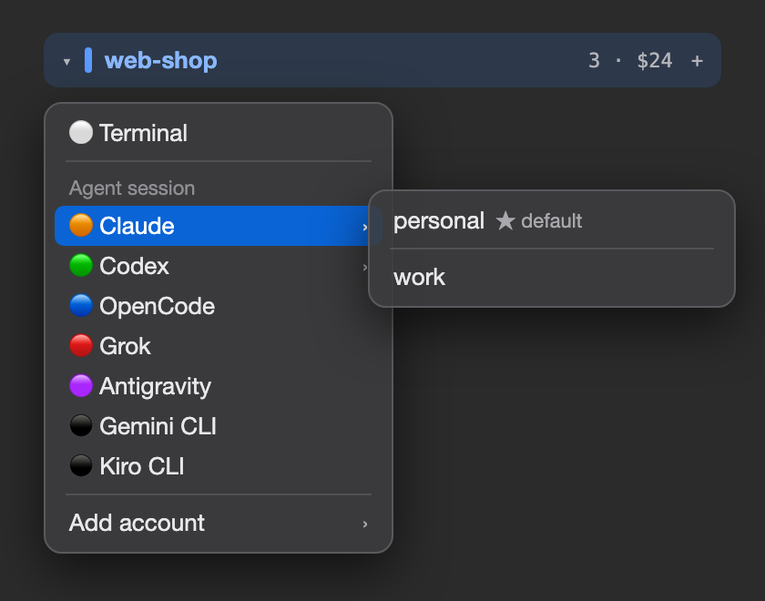

A drawing with sample names. The menu is a system menu: it cannot draw a logo or a text colour. The items are plain names with no colour mark, because a colour per tool is used nowhere else in the panel.

Claude Code, Codex, OpenCode and Grok start through `agent-run.sh`, with the account you pick. Antigravity (`agy`) and the extra tools below have one account and start by their own command.

#### More terminal agents

The watcher knows 11 more terminal agents. Each is listed only when two things are true: its data folder exists, and your login shell finds its command. A folder alone is not enough, because an editor of the same vendor can leave one.

| Tool | Command | Data folder |
|------|---------|-------------|
| Gemini CLI | `gemini` | `~/.gemini` |
| Qwen Code | `qwen` | `~/.qwen` |
| Kimi Code | `kimi` | `~/.kimi-code` |
| Auggie | `auggie` | `~/.augment` |
| Cline | `cline` | `~/.cline` |
| Droid | `droid` | `~/.factory` |
| Kiro CLI | `kiro-cli` | `~/.kiro` |
| Crush | `crush` | `~/.local/share/crush` |
| Goose | `goose` | `~/.config/goose` |
| Copilot CLI | `copilot` | `~/.copilot` |
| Cursor Agent | `cursor-agent` | `~/.cursor` |

These items get one account and start by their command word. They have no `Add account` item and no `Limits` line.

To add a tool of your own, write one line in `~/.config/cmux/agents-tools`:

```
tool <id> <command> <folder> <Label words>
```

| Part | Rule |
|------|------|
| `id` | `a-z`, `0-9` and `-`, at most 12 characters, a letter first. The ids of the five main tools (`claude`, `codex`, `opencode`, `grok`, `agy`) are refused. An id of an extra tool in the table above replaces that entry |
| `command` | One word of `a-z`, `0-9` and `-`, at most 24 characters. The login shell runs it by name through your `PATH`: no path, no arguments |
| `folder` | Starts with `~/` or `/` and must be inside your home folder. The tool counts as present when the folder exists and the command is found |
| `Label words` | The name in the menu: letters, digits, spaces, `.` and `-`, at most 20 characters |

A line that breaks a rule is skipped. The watcher names it by its number only (on standard error); it does not print the text. Lines that start with `#` and empty lines are ignored. The file is read up to 20000 characters. At most 20 extra tools reach the menu. An example with an invented tool:

```
tool mytool mytool ~/.mytool My Tool
```

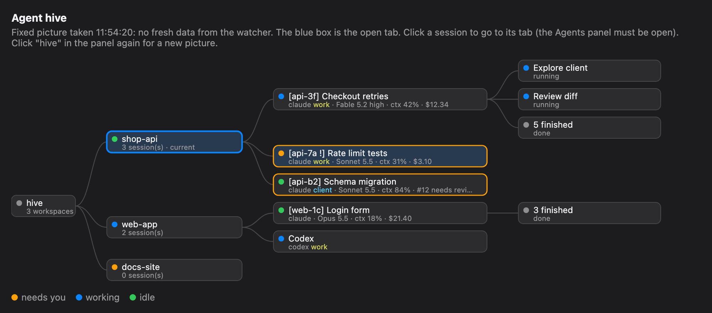

#### Open config

`Open config` lists the config files that exist on this Mac, by tool, then the files of the project of that workspace. An item reads `Claude · settings.json`, `Claude · work · settings.json` (an extra account) or `Project · .mcp.json`. A file that does not exist has no item, and a menu with no file is not shown. Click an item: a new tab opens and runs your editor on that file. The editor is `$EDITOR` of your login shell, else `vi`; `$EDITOR` may hold arguments (`code -w`). The panel never shows the content of a file, because these files can hold secrets.

| Level | Tool | Files |
|---|---|---|
| User | Claude Code | `settings.json`, `CLAUDE.md` in `~/.claude` and in the folder of each account of your accounts file |
| User | Codex | `config.toml`, `AGENTS.md` in `~/.codex` and in each account folder |
| User | Grok Build | `config.toml` in `~/.grok` and in each account folder |
| User | OpenCode | `opencode.json`, `opencode.jsonc` in `~/.config/opencode` (its account variable moves the data folder, not this one) |
| User | Gemini CLI | `settings.json`, `GEMINI.md` in `~/.gemini` |
| Project | any | `CLAUDE.md`, `.claude/settings.json`, `.claude/settings.local.json`, `.mcp.json`, `AGENTS.md`, `.codex/config.toml` in the folder of the workspace |

Limits: a folder whose path holds a space or another character outside `a-z`, `A-Z`, `0-9`, `.`, `_`, `-` gets no item, and nothing outside your home folder is offered. A file name with `auth`, `credentials`, `.key`, `.pem` or `.claude.json` is never offered. Antigravity, Cursor and the extra tools of the start menu have no item: their config file names were not checked against their docs, and a config folder can hold login data. A tool whose config file name was not checked is left out.

### The views page

`views ↗` opens one page with ten views. The page opens on the view that you used last. A click on a session, in any view, goes to its tab.

| View | The picture | The question it answers | Data |
|------|-------------|-------------------------|------|
| Hive | A tree: workspace → session → subagent. A session carries its context tokens beside the share. A Codex session gets its context share from its newest Codex session file | What runs where? | Live |
| Timeline | One lane per session; a block per state: blue works, orange waited for you, pale green idle. Ranges: auto (fits the history that exists), 1h, 6h, 24h, 7d. On top, `Agents at work`: how many sessions worked at one time (blue steps) and how many waited for you (orange). On a lane: `◇` = context compacted, `○` = prompt cache went cold, a thin grey bar under the blocks = one subagent run. A red dashed line = a limit reached 80% | How long did each agent work, and how long did it wait for me? How many work at once? | History |
| Cost | One bar per workspace, one part per session, the largest first; the length is the cost, the tint is the model, a paler part is a session closed today, and the grey part at the end holds the small ones. A tile gives the rise recorded since 00:00. It holds the open sessions and the ones closed today, each with its whole cost. Below it, a ranked list of the sessions, then `Cost per hour`: one bar per hour of the last 12, stacked by model | Where does the money go, and how fast? | Live and history |
| Flow | Bands from workspace to model (and from account, when you use more than one); the width of a band is the cost. It counts the open sessions and the ones closed today | Which workspace spends on which model? | Live and history |
| Limits | One card per limit window: the share in big figures, a verdict (`about 81% at the reset` or `100% Sat 19:57`), the readings, then a dashed line to the reset. A red card reaches 100% before the reset | Will I hit a limit before it resets? | History |
| Queue | One bar per waiting session; the longest wait is first. Orange asks you; a grey bar is a session that is done and waits for your next prompt. Below, `How fast you answer`: the waits of the last 7 days that ended with your answer, counted by length, with the median as a figure | Who waits for me longest? How long do I keep agents waiting? | Live and history |
| Context | One gauge per session, fullest first, with the number of compactions (`⟳`). `–` = not known: after a compaction or a resume Claude Code gives no figure until the next reply. The line under a gauge is the share over the last 6 hours: it falls at a compaction; the dotted line is 80% | Which session must I compact or restart? | Live and history |
| Inside | One card per Claude Code session (a Codex session gets a card with its tool calls only): tool calls by tool (MCP servers and skills in a second grey), an estimate of what fills the context by kind, failed tool calls and API errors, hook runs with the hook errors and their total time, the edited files, files that another session also edited (yellow), silent subagents. Sessions with 5 failures in a row come first | What does each agent do inside, and is one stuck? | Live |
| Rhythm | A grid of hours × the last 7 days, then a calendar of days (a week per row, up to 5 weeks); darker = more agent work | When do my agents work? | History |
| Setup | The first card is the user folder of Claude Code (`~/.claude`), which every session loads; then one card per workspace: the instruction files with their sizes, and counts of skills, agents, commands, rules, hooks and MCP servers. A file that imports others with `@path` lines shows the size of the imports too ("234 B + 9.1 KB imports"). A file over 40 KB with its imports is yellow. A workspace card also shows the project memory of Claude Code: the index file `memory/MEMORY.md` with its size, and the number of memory files. A second card shows the Codex folder. A tile counts the different skills that the open sessions called, beside the number of skills in the user folder. It shows what the folder holds, not what was loaded | What does this workspace give its agents? | Live |


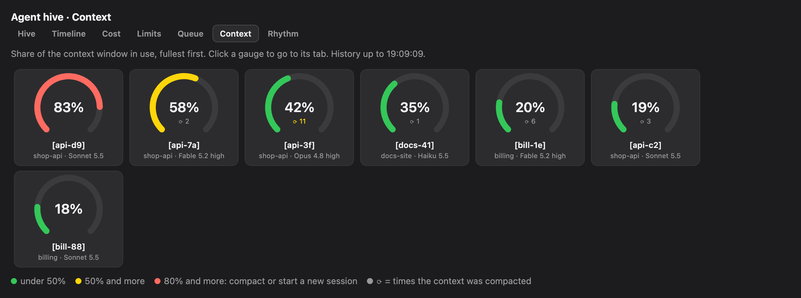

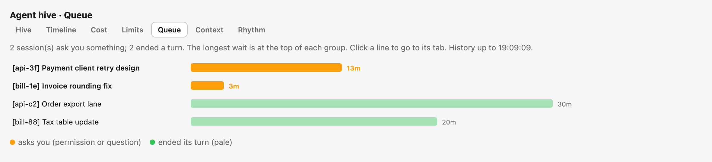

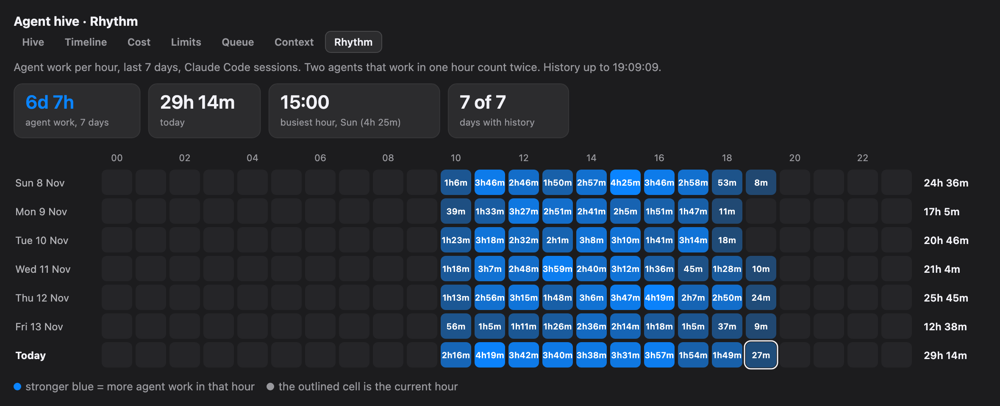

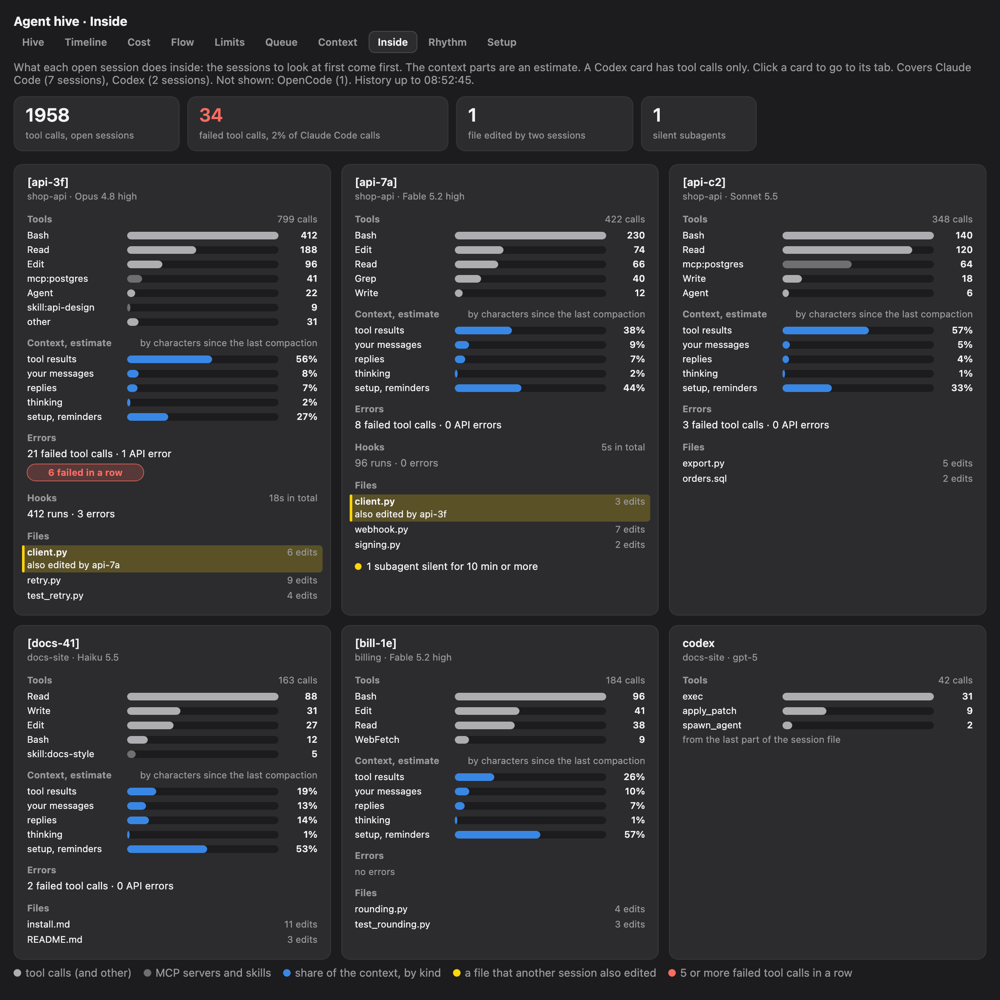

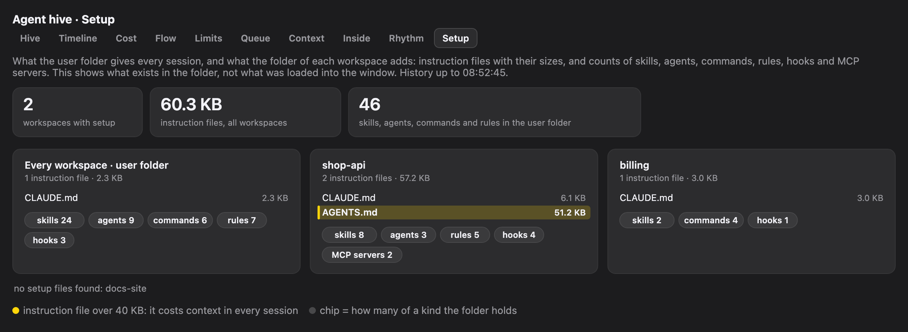

The pictures are renders of `scripts/hive.html` with sample data.

- Each view starts with its main figures in big type, for example the time the agents worked and the time sessions waited for you.
- "History" views fill while the watcher runs. On the first day they hold little.
- The history covers Claude Code sessions. Other tools publish no session state.
- A gap in a lane is a time when the watcher did not run (the Mac slept, or the watcher was stopped).
- The forecast is a straight line from the last readings. It knows nothing about your plans.
- From the panel: right-click a row → `Show in views` → `Timeline`; right-click a limit line → `Show the limit forecast`; right-click a cost line → `Show the cost map`; right-click a row → `Show in views` → `Hive` (the session is the open box), `Inside` or `Setup`. `Cost`, `Queue` and `Context` have no item: they do not mark one session.

### The Limits view in the panel

The `Limits` view of the panel (the segment next to `Sessions`) has two groupings. Both show a bar and a percent per window: green, orange from 50%, red from 80%. The pair `by account` / `by tool` under the first row changes the grouping, and it is the only control in this view. `by account` is the default, and the choice is not saved: after a panel reload it is `by account` again.

**Per account** (`by account`). Each account is a group.

- The account name is a small muted header. The account of the tool's normal folder (the `default` line) comes first, the other accounts follow by name.
- Under it, each tool with its windows. The tool name shows once; the 5-hour and the week window are separate lines.
- The tools of that account with no limit data share one muted `no data` line.
- The cost of that account ends its group.
- Tools that have no account name come last, under `other` (for example OpenCode or Grok on its normal folder).
- With one account and no accounts file there is no header.


**Per tool** (`by tool`). Each tool is a group.

- The tool name is the header. Under it, each account once with its windows, then the accounts of that tool with no data on one muted `no data` line.
- Tools with no window and no account come last, under `other`.
- The cost lines, one per account, follow in a group `cost`.

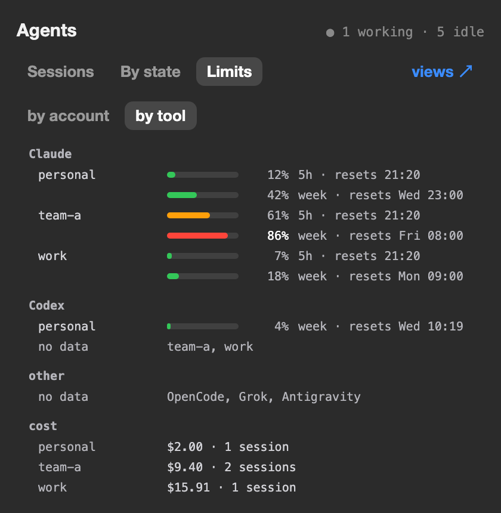

Both are drawings with sample names, made from `examples/limits.html` and `examples/limits-tools.html`.

A tab title, as `label-tabs.py` writes it:

| Tab title | Meaning |
|-----------|---------|
| `[api-3f] Checkout retries` | Session `api-3f` |
| `[api-7a !] Rate limit tests` | The session waits for you |
| `[api-b2 ?] Schema migration` | The session is busy, and its transcript was quiet for 20 minutes |

A workspace description, as `label-tabs.py` writes it:

```text
shop-api | @week: 36% | api-3f: Fable 5.2 high · ctx 42% · $12.34 · sub 2/7: Explore payment client; Review retry diff | api-7a: Sonnet 5.5 medium · ctx 31% · $3.10 · waits permission prompt
```

The field `sub 2/7: Explore payment client; Review retry diff` means: the session started 7 subagents, 2 run now, and these are the names of the running ones.
The hive page shows the 2 by name and the other 5 as one box, `5 finished`.

## Before you install

You need:

- macOS with cmux. The panel was written against cmux 0.65.2. Custom sidebars must be available in your build: `cmux sidebar --help` must work.
- `jq` and `python3` on your `PATH`.
- Claude Code, only if you want session names on tabs and the status line parts.

## Install

1. Clone the repository.

   ```sh
   git clone https://github.com/vasilyu1983/cmux-agents-sidebar.git
   cd cmux-agents-sidebar
   ```

2. Run the installer in Terminal.

   ```sh
   bash install.sh
   ```

   If you have your own Claude Code status line and want to keep it, run this instead:

   ```sh
   bash install.sh --no-statusline
   ```

3. Open a tab in cmux and start the watcher. Leave the tab open.

   ```sh
   ~/.config/cmux/scripts/agents-watch.sh
   ```

The panel shows in the right sidebar. Claude Code sessions that start after the install show the status line.

### What the installer changes

| File | Action |
|------|--------|
| `~/.config/cmux/sidebars/agents.js` | The panel |
| `~/.config/cmux/scripts/label-tabs.py` | Puts session names on tabs and passes session data to the panel |
| `~/.config/cmux/scripts/agents-watch.sh` | Opens the panel and runs `label-tabs.py` every 15 seconds |
| `~/.config/cmux/scripts/hive.html` | The graph page |
| `~/.config/cmux/scripts/next-waiting.sh` | Goes to the session that has waited the longest |
| `~/.config/cmux/scripts/agent-run.sh` | The launcher for several accounts. It does nothing until you use it |
| `~/.config/cmux/scripts/agents-account-add.sh` | Makes the folder and the links of one extra account, when you run it |
| `~/.config/cmux/scripts/agents-shell.sh` | The short commands. They load only after you add the `source` line to your shell file |
| `~/.claude/statusline-command.sh` | The status line script (skipped with `--no-statusline`) |
| `~/.claude/settings.json` | Gets one key, `statusLine`, only when the file has none (skipped with `--no-statusline`) |

If a target file exists and differs, the installer first copies it to `<name>.<date>.bak`.
The installer does not change `cmux.json`, your shell files or the accounts file.

Files that appear later, while the kit runs:

| File | Written by | Content |
|------|------------|---------|
| `~/.cache/cmux-agents/<session id>` | The status line | Model, context, cost and limit figures of one session |
| `~/.cache/cmux-agents/<session id>.seen` | `label-tabs.py` | How far the transcript was read, the compaction count, the last `Next:` line, the start of the last request and the session title |
| `~/.cache/cmux-agents/<session id>.inside` | `label-tabs.py` | Counts from the transcript: tool calls per tool, errors, characters per part of the context, and the paths of edited files (mode 600) |
| `~/.cache/cmux-agents/limit-warned` | `label-tabs.py` | The limit windows that already got a warning, so each one warns once |
| `~/.config/cmux/scripts/hive-data.js` | `label-tabs.py` | The data of the hive page; it holds your session titles (mode 600) |
| `~/.config/cmux/scripts/history-data.js` | `label-tabs.py` | The history for the Timeline, Cost, Limits, Queue, Context and Rhythm views: at most 30 days (mode 600) |
| `~/.config/cmux/agents-accounts` | You, or `agents-account-add.sh` | The account list and the folder rules |
| `~/.config/cmux/agents-tools` | You | Start-menu tools of your own, one `tool` line each (see "The start menu") |
| `~/.cache/cmux-agents/tools-on-path` | `label-tabs.py` | Which tool commands your login shell found; asked at most once in 10 minutes (mode 600) |

The `statusLine` key that it adds:

```json
{ "statusLine": { "type": "command", "command": "bash ~/.claude/statusline-command.sh" } }
```

| State of `~/.claude/settings.json` | What the installer does |
|------------------------------------|-------------------------|
| No file | Creates the file with this key only |
| File without `statusLine` | Keeps a `.bak` copy, adds the key, changes no other key |
| File with this status line | Changes nothing |
| File with another `statusLine` | Changes nothing and says so |
| File that `jq` cannot read | Changes nothing and says so |

### Install by hand

Copy `sidebars/agents.js` to `~/.config/cmux/sidebars/`, then run:

```sh
cmux sidebar validate agents
cmux right-sidebar set custom agents
```

The panel works without the other files. You then get the rows, the status, the search and the jump. You do not get session names on tabs, model, context, cost, or the hive page.

### Optional: a palette entry and a shortcut

Add this to the `actions` object in `~/.config/cmux/cmux.json`, then run `cmux config validate` and `cmux reload-config`.

```json
"agents-panel": {
  "type": "command",
  "title": "Agents",
  "command": "~/.config/cmux/scripts/agents-watch.sh",
  "target": "newTabInCurrentPane",
  "shortcut": "cmd+ctrl+a",
  "palette": true
},
"agents-next-waiting": {
  "type": "command",
  "title": "Next waiting agent",
  "command": "~/.config/cmux/scripts/next-waiting.sh",
  "target": "newTabInCurrentPane",
  "shortcut": "cmd+ctrl+n",
  "palette": true
}
```

## Fast commands

A right-click on a session row offers the tool's own commands.

| Tool | Compact | Usage or context | Menu action |
|------|---------|------------------|-------------|
| Claude Code | `/compact` | `/context` | Sends the command to the tab, only while the session is idle |
| Codex | `/compact` | `/status` | Copies the command |
| OpenCode | `/compact` | none | Copies the command |
| Grok Build | `/compact` | `/context` | Copies the command |
| Antigravity (`agy`) | none, it compacts by itself | `/context` | Copies the command |

Two cautions about the send action:

- It types into the tab and submits. If you left a draft in the input box of that session, the draft is submitted with the command.
- It runs only on an idle session. On a session that works or waits, the text could answer a prompt, so the item does nothing.

The other tools only copy, because their waiting state in cmux is not confirmed yet. To change a tool to sending, add `send: true` to its line in `COMMANDS` at the top of `agents.js`. To add a tool, add a line there.

## Several accounts

The full guide, with setup, maintenance and a fault table, is [ACCOUNTS.md](ACCOUNTS.md).

You can keep a personal account and a work account of the same tool logged in at once, and let the folder decide which one a session uses. Each account is a separate data folder of the tool; a launcher sets one variable before the tool starts.

| Tool | Variable that the launcher sets | Status |
|------|--------------------------------|--------|
| Claude Code | `CLAUDE_CONFIG_DIR` | Documented by Claude Code for work and personal accounts. On macOS the Keychain entry is per folder. |
| Codex | `CODEX_HOME` | Named in `codex --help`. |
| OpenCode | `XDG_DATA_HOME` | Its login file and sessions are in the data folder. The variable also reaches each command that OpenCode runs. |
| Grok Build | `GROK_HOME` | xAI documents it as the home for config, auth, sessions, skills, plugins and logs ([settings reference](https://docs.x.ai/build/settings/reference)). The author moved Grok's data folder with `GROK_HOME` in a test and did not test a second Grok login. `agents-account-add.sh grok <name>` links nothing: the new account starts with its own settings, and you log in by hand with the command that the script prints. |
| Antigravity (`agy`) | none found in its help | One account. The launcher refuses it; start it as before. |

The accounts file is `~/.config/cmux/agents-accounts`. Without it, everything works as before. [`examples/agents-accounts.example`](examples/agents-accounts.example) is a start:

```
account claude work ~/.claude-work
account codex work ~/.codex-work
rule ~/Projects/work work
default personal
```

- `account <tool> <name> <folder>`: the data folder of one account. The name has 1 to 16 characters from `a-z`, `0-9` and `-`. The folder must be under your home folder.
- `rule <folder prefix> <name>`: a session started in that folder, or below it, uses that account. The longest matching prefix wins.
- `default <name>`: the account when no rule matches.
- Keep your first account in the tool's normal folder: name it on the `default` line and give it no `account` line. Only the extra accounts get a folder, so no account has two histories. `agents-account-add.sh` refuses a folder for the default name.
- A name with no `account` line for a tool means the tool's normal folder (`~/.claude`, `~/.codex`). In the example, `personal` is the login that you have today.

Two scripts:

- `scripts/agents-account-add.sh <tool> <name>` makes the folder `~/.<tool>-<name>` and adds the `account` line. With `--dry-run` it only prints. At the end it prints the one login command; you run it and log in yourself.
- `scripts/agent-run.sh <tool> [arguments]` chooses the account and starts the tool with your arguments unchanged. `agent-run.sh --which <tool>` prints the name. `AGENT_ACCOUNT=<name>` overrides the rules for one start. An unknown name or a missing folder is an error, and the tool does not start.

To use the launcher for every start, add one line to `~/.zshrc` (or `~/.bashrc`) yourself:

```zsh
source ~/.config/cmux/scripts/agents-shell.sh
```

It gives short commands:

| Command | What it does |
|---|---|
| `claude`, `codex`, `opencode`, `grok` | Start with the account that the folder rules choose |
| `cla work` | Claude Code with the account `work`, for this start only |
| `cdx work` | Codex with the account `work`, for this start only |
| `accounts` | Prints the account list and the account that the current folder gets |
| `accounts doctor` | Checks the folder and the links of every extra account, and adds missing links |

What an account folder shares: `agents-account-add.sh` links a fixed list of setup files from the tool's normal folder, when they exist there. It never replaces a real file in the account folder. Run it again for an existing account to add links that a newer version of the list holds.

| Tool | Linked | Separate for each account |
|---|---|---|
| Claude Code | `settings.json`, `CLAUDE.md`, `hooks`, `rules`, `skills`, `agents`, `commands`, `output-styles`, `plugins`, `statusline-command.sh`, `workflows`, `keybindings.json`, `teams` | The login, sessions and `/resume`, project memory, history, MCP servers added at user level |
| Codex | `config.toml`, `AGENTS.md`, `instructions.md`, `hooks.json`, `rules`, `skills`, `agents`, `plugins`, `keybindings.json` | The login, sessions, memories, history |
| OpenCode | nothing; its settings stay in `~/.config/opencode` | The login and the sessions |
| Grok Build | nothing; `GROK_HOME` holds the settings too, so the account starts with its own | Everything: settings, login, sessions, skills, plugins, logs |

A tool that saves a linked file by replacing it turns the link into a real file of that account. Run the script again to see the state of each link.

Where you see the account:

- The status line of a Claude Code session starts with the account name when the session runs on an extra account. A session on the default account shows no name.
- A panel row names the account in a pill (`work`), in the colour of the account. For Codex the watcher reads one variable, `CODEX_HOME`, from the process of that tab. A Grok row has no account pill: the watcher does not read `GROK_HOME`.
- The detail lines of a row hold `account`; a session on the default account reads `personal (primary)`, with the name from your `default` line.
- `Limits` names the default account on the lines of the normal folder of Claude Code and Codex. A Grok account that you added has its own group, with a `no data` line.
- The account name has one fixed colour on the row tag, on the hive page and in the status line. The status line takes the name from the folder (`~/.claude-work` gives `work`), so the colours match when the folder follows that pattern.
- `≠ work` on a row means that the folder rules name another account for that folder than the one the session runs on. Start the session again with the right account.
- `accounts doctor` checks the folder and the links of every extra account in one run.

Limits to know:

- If a link is missing, that account runs without the part. A missing `hooks` or `settings.json` link means your hooks and permission rules do not run there. Read the table that the script prints.
- `/resume` and `--resume` see only the sessions of the account in use. Under cmux, `claude --resume <id>` with an id that is stored in `~/.claude` moves that start to the normal folder, and so to that account.
- The folder does not separate every sign-in. `ANTHROPIC_AUTH_TOKEN` and `CLAUDE_CODE_OAUTH_TOKEN` in the environment rank above the login of any folder; so does `ANTHROPIC_API_KEY` outside cmux (the cmux wrapper removes it). Claude Code stores a Console sign-in without an API key outside the folder.
- The linked `settings.json` applies to every account. If it sets `apiKeyHelper`, a credential in `env`, `forceLoginMethod` or `forceLoginOrgUUID`, all accounts get that sign-in rule, and `forceLoginOrgUUID` can refuse the login of the second account. In that case give the account its own `settings.json` in place of the link.
- With an accounts file, the launcher removes an inherited `CLAUDE_CONFIG_DIR`, `CODEX_HOME` or `GROK_HOME` when the chosen account uses the normal folder. It leaves `XDG_DATA_HOME` alone.
- The plan terms of each tool are your responsibility. Separate accounts for separate work are one thing; several accounts to pass a usage limit can break the terms.
- The scripts read, copy and move no login token. They make folders and links, write one line of text, and set one variable.

## How it works

A cmux panel gets workspaces, tabs and agents from cmux. It cannot read a file, and cmux does not know the model or the cost of a session. So the data takes this path:

1. The status line script runs inside each Claude Code session. It writes one small file per session to `~/.cache/cmux-agents/<session id>`: model, context share, cost, lane branch, cold-cache tokens, the limit figures (5 hours and 7 days, with reset times), the name of the account folder and the context tokens of the last call, separated by tabs.
2. `label-tabs.py` reads the Claude Code session registry (`~/.claude/sessions/`) and those files. It renames each tab to `[session name] title`, with `!` for a waiting session and `?` for a busy session whose transcript was quiet for 20 minutes.
3. `label-tabs.py` writes the session data into the workspace description: `<folder> | @week: 36% | api-3f: Fable 5.2 high · ctx 42% · $12.34`.
   For each Claude Code session it also adds the subagents that Claude Code recorded on disk: `sub 2/7: Explore repo; Review diff` means 2 run now, 7 in all.
4. The panel reads the description and joins it with the rows.

Facts that follow from this design:

- The workspace description belongs to this tool. The text before the first ` | ` is kept; the rest is rewritten every 15 seconds.
- Only Claude Code sessions get a name, model, context and cost. Other tools show their status, title and tool tag. A Codex tab also gets its context share, but only when no other live Codex tab uses its Codex folder: the newest session file of a folder cannot be tied to one tab.
- The cost is the Claude Code estimate at list price for one session. It is not your bill.
- The `?` mark is a hint. A long silent command also leaves the transcript quiet.
- The hive page gets its first data in the link, after `#`. After that it reads `hive-data.js`, a file that `label-tabs.py` writes next to the page every 15 seconds (mode 600; it holds your session titles). The page loads nothing from the network. Only Claude Code sessions update, and Codex tabs that have a context figure; other tools keep the state of the first picture. Without a fresh file the page says "Fixed picture".
- The panel saves your view (chip, sort, scope, ended rows, folds) in a description part, `@view: ...`, on a click. `label-tabs.py` keeps that part, so the view returns after a panel reload.
- For the next step and the compaction count, `label-tabs.py` reads the transcript of each live Claude Code session, only the part that is new since the last pass. It keeps the position, the count and the one `Next:` line in `~/.cache/cmux-agents/<session id>.seen` (mode 600). A new request of yours clears the line.
- For the work marks it asks `git` in the start folder of each session: the branch, and the commits of `HEAD` that no remote branch holds. It never fetches, so the count is as fresh as your last fetch or push. `main`, `master`, `dev`, `develop` and `trunk` never count as a duplicate.
- `label-tabs.py` deletes files in `~/.cache/cmux-agents` that are older than 14 days.
- The account of a session comes from its data folder: the status line passes the folder name for Claude Code, and `label-tabs.py` reads the variable `CODEX_HOME` of a Codex tab. The accounts file maps the folder to a name. A Claude Code row gets its account after the first reply of the session.
- The limit warning is a `cmux notify` call from `label-tabs.py`: one per limit window at 80% or more. A window that drops below 80% can warn again.
- A limit line stays empty until the tool sent a figure. Claude Code sends none before the first reply of a session, and it can send a week figure without a 5-hour figure.
- The `Limits` view reads local files only: the Claude Code status line data, and the `rate_limits` record in the newest Codex session file (`~/.codex/sessions`). It reads no login token and calls no network. A figure is as old as the tool's last reply, so each line shows its age. A tool that is installed and leaves no limit data is named on the muted `no data` line of its group; this is the case for OpenCode, Grok Build and Antigravity today. The Claude Code lines need the status line of this repository.
- A click on a session in the hive page goes to its tab. A web page cannot call cmux, so the page puts the request in its tab title for 5 seconds (`go:<workspace id>:<tab id>:<time>`), and the panel, which gets tab titles from cmux, focuses that tab. The panel must be open. It accepts only ids of tabs that it knows and a request younger than 20 seconds, and a request can do nothing but change the focus.
- The hive page shows subagents under their session. It uses what cmux reports; when cmux reports none, it uses the Claude Code records: the running ones by name, the finished ones as a count. A subagent counts as running while its record is not finished and its transcript got a line in the last 15 minutes.

### Optional project strip

The top of the panel can show a few lines of project state, for example a merge queue. A watcher of your own supplies them:

- Set `AGENTS_STRIP_WORKSPACE` to a workspace ref (for example `workspace:3`) and `AGENTS_STRIP_TEXT` to one line of text when you run `label-tabs.py`. The text shows as the `train` line.
- A PR badge on a row needs two files in `$TMPDIR/agents-board/`: `prs.json` (output of `gh pr list --json number,headRefName`) and `status.txt` (your merge tool's state lines). Without them the badge stays off.

Without a watcher of your own the strip shows only the limit lines, one per tool.

## Privacy and safety

- Everything stays on your Mac. No script calls the network.
- `label-tabs.py` reads the environment of your own agent processes to find two values, `CMUX_SURFACE_ID` and `CODEX_HOME`. It keeps nothing else from it.
- The only message that the kit sends is a local cmux notification for a limit warning.
- A start item of a workspace menu opens a tab with one fixed command: `agent-run.sh`, a tool from a fixed list of four (`claude`, `codex`, `opencode`, `grok`), and an account name that holds only `a-z`, `0-9` and `-`. For Antigravity the command is the fixed word `agy`. For an extra tool the command is one checked word (`a-z`, `0-9`, `-`; no path, no argument) that the login shell finds by name. An `Add account` item opens a tab that asks you for a name and passes it to `agents-account-add.sh`, which checks it. No other text reaches the shell. The launcher sets the tool's one folder variable and reads no login data.
- An `Open config` item opens a tab with one fixed command: `sh -c` runs `${EDITOR:-vi}` on one path, `$HOME/<folder>/<file>`. The file name comes from a fixed table (the table above), and the folder is a path below your home folder of plain characters (`a-z`, `A-Z`, `0-9`, `.`, `_`, `-`; no `..`), from the accounts file or from the workspace folder. The watcher and the panel both check every part, and no title, PR text or other free text reaches the command. `label-tabs.py` only tests with `os.path.isfile` whether each file of the table exists. It opens no config file, reads no value, and publishes the folder and the file name in the workspace description (`@cfg:` for the user files, `@proj:` for the project files).
- For each workspace folder that is a git clone, `label-tabs.py` asks git for the origin URL (`git config --get remote.origin.url`, once in 10 minutes; the folder comes from cmux `workspace.list` when the description names none) and keeps only its last part, the repository name. When that name differs from the folder name (a lane or worktree folder), it writes `@repo: <name>` into the workspace description, and the panel names the group after the repository. The rest of the URL, such as the host and owner, is not kept.
- For the extra tools of the start menu, `label-tabs.py` does three things. It checks with `os.path.isdir` whether the data folder of each listed tool exists, and reads nothing inside it. It asks your login shell `command -v <name>` for the command names of the tools whose folder exists, at most once in 10 minutes, and keeps the answer (tool commands found or not) in `~/.cache/cmux-agents/tools-on-path` (mode 600). It reads your own file `~/.config/cmux/agents-tools`. The ids, commands and labels of the tools found go into the workspace description (`@tools:`), and the panel checks every part again before it builds a command.
- `label-tabs.py` reads the transcripts of your live Claude Code sessions on disk. One line of the last reply, the `Next:` line, goes into the workspace description and the hive data file; no other reply text leaves the transcript.
- From the same transcript `label-tabs.py` takes the title of the session (the one you set with `/rename`, else the one the tool gave it), cut to 48 characters. It goes into the workspace description and into `~/.cache/cmux-agents/<session id>.seen`, and the panel shows it on a tab with no title of its own.
- The start of your last request (60 characters) also goes into the workspace description.
- For a tab that runs Codex, OpenCode, Grok or Antigravity, `label-tabs.py` asks cmux for the last 30 lines on screen (`cmux read-screen`). It tests the last 12 of them that hold text for two fixed interface lines and keeps one word: `working`, `asks` or `idle`. No screen text is stored or shown.
- `label-tabs.py` keeps a history file, `~/.config/cmux/scripts/history-data.js`, for the views page. Every 15 seconds it records, per live Claude Code session: the session id, the session name (the one you gave it, else the short one of the tool, at most 60 characters), the workspace name, the state (working, needs input, idle) with start and end times, the model, the context share, the cost and the account name. It also records each limit figure with its time; a sample of the context share and the cost per session (one per minute at most, when a figure changed, kept for one day); the time of each compaction and of each cold prompt cache; and per subagent of a live session its agent type (for example `Explore`) with the start and end time, taken from the file times of its transcript. It holds no request text and no reply text. It keeps 30 days, is readable by you only (mode 600), and never leaves your Mac. `uninstall.sh` removes it.
- For the context share of a Codex tab, `label-tabs.py` reads token counters (numbers only) from the newest Codex session file of that Codex folder. It keeps no text from that file.
- From the same part of the transcript `label-tabs.py` also keeps counts in `~/.cache/cmux-agents/<session id>.inside` (mode 600). It keeps:
  - the name of each tool that the session called, with a count. A tool of an MCP server counts under the server name. A skill counts under the skill name.
  - the number of tool results that failed, the number of API errors, and how many tool results failed in a row at the end.
  - the number of characters per part of the context since the last compaction: tool results, your messages, replies, thinking and attachments (instructions, skill and tool lists, hook output, files). Only the lengths, never the text.
  - the full path of each file that the session edited, with a count and a time. At most 50 paths.
  - It keeps no message text, no tool input and no tool output. The hive data file gets the counts, and the file names without their folders.
- `label-tabs.py` compares the edited paths of your live sessions, to find two sessions that edited the same file in the last 6 hours. The hive data file then names the file and the other session.
- From the same transcript it counts the runs of hooks: per run the kind of record, the exit code and the run time. From the hook summary at the end of a turn it takes the number of hooks that reported an error. It keeps three sums (runs, errors, time). It keeps no hook command, no hook output and no error text.
- For each workspace it looks at the project memory of Claude Code (`~/.claude/projects/<folder>/memory`): the size of `MEMORY.md` and the number of `.md` files. It reads no memory file.
- For the Codex folder `~/.codex` it keeps the size of `AGENTS.md`, the entry counts of `skills`, `agents`, `prompts` and `rules`, and the number of tables under `mcp_servers` in `config.toml`: no value. From the read part of the newest Codex session file it also counts the tool calls by tool name: no argument and no output.
- Four numbers also go into the workspace description: the errors, the failed tool results in a row, the files that overlap with another session, and the silent subagents.
- For each workspace `label-tabs.py` looks at the start folder of its first session. It keeps the names and sizes of `CLAUDE.md`, `AGENTS.md`, `GEMINI.md` and `.claude/CLAUDE.md`. It counts the entries in `.claude/skills`, `.claude/agents`, `.claude/commands` and `.claude/rules`. It reads no file in those folders. From `.claude/settings.json` it counts the keys under `hooks`, and from `.mcp.json` the keys under `mcpServers`. It never keeps or shows a value from these files. The counts go into the hive data file only. For the user folder `~/.claude` it does the same: the size of `CLAUDE.md`, the entry counts of `skills`, `agents`, `commands` and `rules`, and the number of keys under `hooks` in `settings.json`. It reads no value and no other key. An instruction file can import other files with `@path` lines. The watcher reads those lines, follows them up to 5 levels, and keeps only the summed size of the imported files: no path and no text.
- For the `?` mark, `label-tabs.py` also reads the file times of the subagent transcripts of a session. It reads no content from them. These file times and the "finished" mark in the subagent record give the count of silent subagents: not finished, and no line for 10 minutes.
- The views page stores two words in the browser's local storage of its cmux tab: the last view and the last time range.
- `~/.cache/cmux-agents` is created with mode 700.
- The panel writes to the clipboard only from a menu item that you click.
- The panel builds no shell command. A strip menu copies the text of its line, or opens the views page; nothing else.

## Remove

Run this in Terminal, in the folder of the repo. The first line shows the plan; the second deletes.

```sh
bash uninstall.sh
bash uninstall.sh --yes
```

It removes the panel, the scripts and `~/.cache/cmux-agents` (that folder holds `tools-on-path`). It never touches your accounts file, your account folders, a login, or the Claude Code settings. It does not remove `~/.config/cmux/agents-tools` either, and its list of what is left for you does not name that file: delete it by hand if you made it.

If you installed the status line: delete `~/.claude/statusline-command.sh` and the `statusLine` key in `~/.claude/settings.json`, or restore your `.bak` copies.
Tab labels stay until you rename the tabs or close them.

## Known limits

- Tested on one Mac with cmux 0.65.2. A newer cmux can change the panel API.
- The tool names that cmux reports for Codex, OpenCode, Grok Build and Antigravity were not observed; only `claude` was. The fast-command match is on a part of the name.
- Fold states reset when the panel reloads.
- The jump from the hive page is new. In tests with a scripted title change it worked in 2 of 3 runs within 3 seconds; cmux can pass a title change late.
- The "Next waiting agent" entry was tested with sample data only. Its palette entry opens a tab to run the script.
- The saved view was tested for the restore; the save on a click was not observed.
- The session cost is a running total. The panel shows no cost per day.
- The wrong-account mark, the limit warning and the Codex account tag were tested with sample data and stub commands, not on live sessions.
- OpenCode, Grok Build and Antigravity leave no limit figure in their local files, as far as their table and key names show. OpenCode keeps a cost per session; the panel does not show it yet.
- The next step, the compaction count and the marks `dup` and `↑` were tested with sample data; on one Mac the next step and the count showed in the data. The new chips `you` and `push` were not seen on screen, and the chip row can be too wide for a narrow sidebar.
- The compact layout, the top rows (counts, `Sessions | Limits`, `Here | All`, chips, search field) and the limit bars were tested in the runtime with invented data; their look on screen (widths, cut text) was not checked by the author of the change.
- `Clear filters` clears the search text that filters the list. The search field may still show the typed text; this was not checked on screen.
- `Terminal` opens a plain tab. A start item such as `Codex` → `team` opens a tab that runs `agent-run.sh` with that tool and account in your login shell; a shell stays open when the tool ends. The start menu needs `agent-run.sh` installed by `install.sh`. Claude Code, Codex, OpenCode and Grok start through the launcher, one item per account. Antigravity keeps one account, so it gets one item that runs its own command (`agy`). An extra tool gets one item that runs its command word. The commands and folders of the extra tools come from each tool's docs or repo; a tool that changes its command or folder drops out of the menu until you fix it in `agents-tools`.
- Several Grok accounts: the author moved Grok's data folder with `GROK_HOME` in a test. A second Grok login was not tested.
- The state from the screen was tested with sample screens only, not with a live Codex or OpenCode tab. A tool that changes its interface lines breaks it. No documented cmux call for that was found.

## License

GPL-3.0-or-later. See [LICENSE](LICENSE).
The panel started from a panel template that ships with cmux, and cmux is licensed under GPL-3.0-or-later.

This project is not affiliated with cmux or its authors.

## Test

```
node tests/smoke.mjs
python3 tests/history.py
```

The test runs the panel inside the sidebar runtime of your installed cmux, with invented data and no socket. It prints `SKIP` when cmux is not installed.
