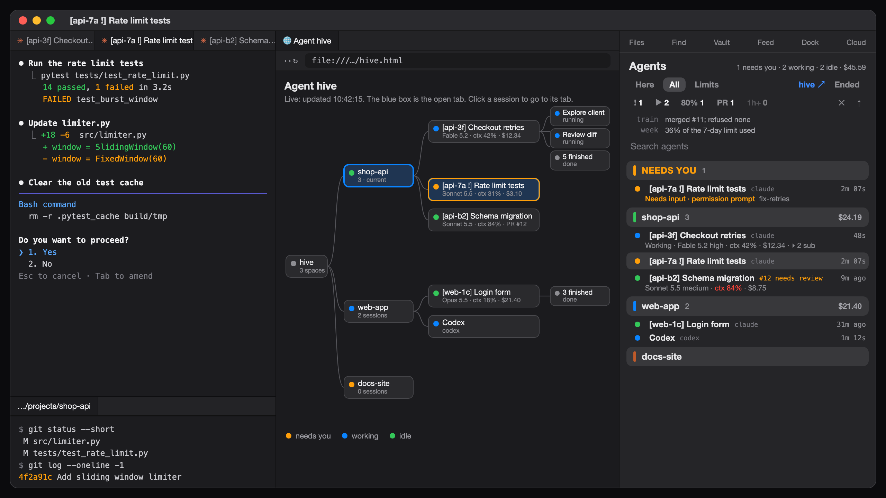
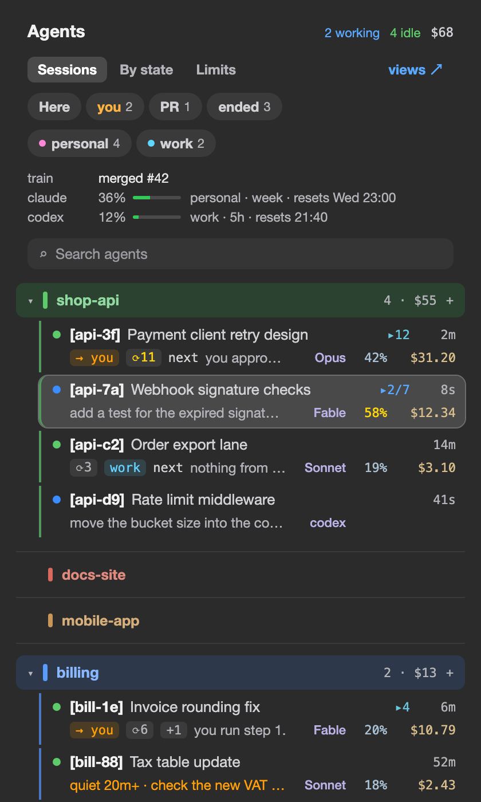
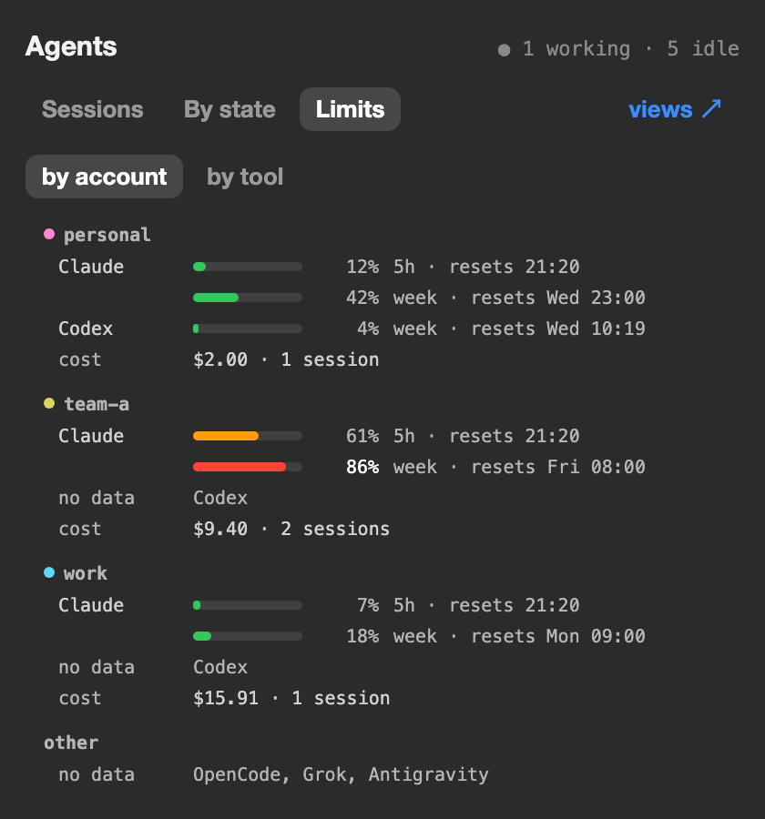

# cmux Agents sidebar

A right-sidebar panel for [cmux](https://github.com/manaflow-ai/cmux) that shows every coding-agent session in every workspace, in one list.
You see who waits for you, who works, and who is idle. You click a row to go to that session.

It is made for people who run many agent sessions at the same time: Claude Code, Codex, OpenCode, Grok Build, Antigravity, or any tool that cmux detects.



A drawing of a cmux window with the panel, with sample names.

## What you get

| Part | What it shows |
|------|---------------|
| One band per workspace | Project folder, colour bar, agent count, summed session cost, unread count. A click opens the workspace |
| One row per session | Status dot, tab title, tool tag, time since the last activity. A click goes to the tab. With an accounts file the tag names the account (`claude · work`), and search matches it |
| `NEEDS YOU` block | All sessions that wait for your input, at the top, with the reason when it is known |
| Filter chips | `!` needs you, `▶` working, `80%` context nearly full, `PR` has a pull request, `1h+` idle for an hour, `you` the next step is yours, `push` commits that no remote holds. Each chip shows its count |
| `↑` sort | Sessions that need attention first; the default order is the tab order |
| `✕` | Back to the default view: no chip, tab order, all workspaces, no ended rows. The search text stays |
| Subagents | `▸ 2 sub` on a row opens the subagent rows. The count comes from cmux, or from the Claude Code records when cmux reports none |
| Details | `›` on a row opens state, tool, folder, branch, ports, first and last request |
| Right-click menu | Go to session, copy name, copy folder, copy PR number, fast commands |
| `hive ↗` | A graph page: workspace → session → subagent, in a cmux browser tab. It updates every 15 seconds. The open tab has a blue box. A click on a session goes to its tab, and the page follows you to another workspace |
| Next waiting | `next-waiting.sh` goes to the Claude Code session that has waited for you the longest |
| `Limits` | Next to `Here` and `All`: the rate limits of each agent tool on this Mac, per window (5 hours, week), with the reset time and the age of the figure. With an accounts file: one line per tool and account. The panel remembers the choice |
| Search | Type in `Search agents`: rows stay when the text is in the tab title (with the session name), the tool, the account, the workspace name or the folder. Capital letters do not matter. A search text looks in every workspace, also with `Here` on. A chip narrows the result further. While `Limits` is on, a search text shows the sessions again |
| Account chips | With sessions on two accounts or more, one chip per account under the filter chips, with its row count. A click shows only that account; a second click, or `✕`, shows all |
| Account colour | Each account name has one fixed colour, the same on the row tag, on the hive page and at the start of the session's status line. There are six colours, so two names can share one |
| Wrong-account mark | `≠ work` in orange on a row: the folder rules name `work` for that folder, and the session runs on another account. Needs `rule` lines |
| Limit warning | One cmux notification when a limit window of any account passes 80% |
| Next step | If the last reply of a Claude Code session ends with a line `Next: ...`, the row details show it. `→ you` in blue on the row when that line starts with `you` or `owner` |
| New tab | Right-click a workspace header, or click its `+`: `New tab here` opens a tab in that workspace |
| Asked or finished | The second line of a row says `asked` when the agent waits for an answer, and `finished · not seen` in blue when it ended its turn and you have not opened the tab. The `✓` chip filters the finished ones |
| Last prompt | The start of your last request to a Claude Code session, in the row details and in the search |
| State from the screen | Codex, OpenCode, Grok and Antigravity tabs publish no state. The row says `working · from screen` or `asked · from screen`, read from the last 30 lines of the tab |
| Work marks | In orange on a row: `dup` when two live sessions work in one folder on one work branch, `↑2` for 2 commits that no remote holds, `3× comp` from the third context compaction |
| Cost per account | In `Limits`, under the limit lines: the summed cost estimate of the open Claude Code sessions per account |

With the optional Claude Code status line, each Claude Code row also shows the model and effort, the context share (red from 80%), the session cost estimate, a `cold` mark when the prompt cache went cold, and the count line shows the summed cost.

Status colours: orange = waits for you, blue = working, green = idle, grey = ended.

## Examples

The pictures use sample names. The panel picture is a drawing of the layout (`examples/panel.html`), with the account chips, the account colours and the wrong-account mark. The hive picture is a render of `scripts/hive.html` with sample data. It was opened without the watcher, so its top line says that the picture is fixed; with the watcher the page updates every 15 seconds.




The `Limits` view with several accounts: one line per tool and account, red from 80%. A drawing with sample names, made from `examples/limits.html`.



A tab title, as `label-tabs.py` writes it:

| Tab title | Meaning |
|-----------|---------|
| `[api-3f] Checkout retries` | Session `api-3f` |
| `[api-7a !] Rate limit tests` | The session waits for you |
| `[api-b2 ?] Schema migration` | The session is busy, and its transcript was quiet for 20 minutes |

A workspace description, as `label-tabs.py` writes it:

```text
shop-api | @week: 36% | api-3f: Fable 5.2 high · ctx 42% · $12.34 · sub 2/7: Explore payment client; Review retry diff | api-7a: Sonnet 5.5 medium · ctx 31% · $3.10 · waits permission prompt
```

The field `sub 2/7: Explore payment client; Review retry diff` means: the session started 7 subagents, 2 run now, and these are the names of the running ones.
The hive page shows the 2 by name and the other 5 as one box, `5 finished`.

## Before you install

You need:

- macOS with cmux. The panel was written against cmux 0.65.2. Custom sidebars must be available in your build: `cmux sidebar --help` must work.
- `jq` and `python3` on your `PATH`.
- Claude Code, only if you want session names on tabs and the status line parts.

## Install

1. Clone the repository.

   ```sh
   git clone https://github.com/vasilyu1983/cmux-agents-sidebar.git
   cd cmux-agents-sidebar
   ```

2. Run the installer in Terminal.

   ```sh
   bash install.sh
   ```

   If you have your own Claude Code status line and want to keep it, run this instead:

   ```sh
   bash install.sh --no-statusline
   ```

3. Open a tab in cmux and start the watcher. Leave the tab open.

   ```sh
   ~/.config/cmux/scripts/agents-watch.sh
   ```

The panel shows in the right sidebar. Claude Code sessions that start after the install show the status line.

### What the installer changes

| File | Action |
|------|--------|
| `~/.config/cmux/sidebars/agents.js` | The panel |
| `~/.config/cmux/scripts/label-tabs.py` | Puts session names on tabs and passes session data to the panel |
| `~/.config/cmux/scripts/agents-watch.sh` | Opens the panel and runs `label-tabs.py` every 15 seconds |
| `~/.config/cmux/scripts/hive.html` | The graph page |
| `~/.config/cmux/scripts/next-waiting.sh` | Goes to the session that has waited the longest |
| `~/.config/cmux/scripts/agent-run.sh` | The launcher for several accounts. It does nothing until you use it |
| `~/.config/cmux/scripts/agents-account-add.sh` | Makes the folder and the links of one extra account, when you run it |
| `~/.config/cmux/scripts/agents-shell.sh` | The short commands. They load only after you add the `source` line to your shell file |
| `~/.claude/statusline-command.sh` | The status line script (skipped with `--no-statusline`) |
| `~/.claude/settings.json` | Gets one key, `statusLine`, only when the file has none (skipped with `--no-statusline`) |

If a target file exists and differs, the installer first copies it to `<name>.<date>.bak`.
The installer does not change `cmux.json`, your shell files or the accounts file.

Files that appear later, while the kit runs:

| File | Written by | Content |
|------|------------|---------|
| `~/.cache/cmux-agents/<session id>` | The status line | Model, context, cost and limit figures of one session |
| `~/.cache/cmux-agents/<session id>.seen` | `label-tabs.py` | How far the transcript was read, the compaction count and the last `Next:` line |
| `~/.cache/cmux-agents/limit-warned` | `label-tabs.py` | The limit windows that already got a warning, so each one warns once |
| `~/.config/cmux/scripts/hive-data.js` | `label-tabs.py` | The data of the hive page; it holds your session titles (mode 600) |
| `~/.config/cmux/agents-accounts` | You, or `agents-account-add.sh` | The account list and the folder rules |

The `statusLine` key that it adds:

```json
{ "statusLine": { "type": "command", "command": "bash ~/.claude/statusline-command.sh" } }
```

| State of `~/.claude/settings.json` | What the installer does |
|------------------------------------|-------------------------|
| No file | Creates the file with this key only |
| File without `statusLine` | Keeps a `.bak` copy, adds the key, changes no other key |
| File with this status line | Changes nothing |
| File with another `statusLine` | Changes nothing and says so |
| File that `jq` cannot read | Changes nothing and says so |

### Install by hand

Copy `sidebars/agents.js` to `~/.config/cmux/sidebars/`, then run:

```sh
cmux sidebar validate agents
cmux right-sidebar set custom agents
```

The panel works without the other files. You then get the rows, the status, the search and the jump. You do not get session names on tabs, model, context, cost, or the hive page.

### Optional: a palette entry and a shortcut

Add this to the `actions` object in `~/.config/cmux/cmux.json`, then run `cmux config validate` and `cmux reload-config`.

```json
"agents-panel": {
  "type": "command",
  "title": "Agents",
  "command": "~/.config/cmux/scripts/agents-watch.sh",
  "target": "newTabInCurrentPane",
  "shortcut": "cmd+ctrl+a",
  "palette": true
},
"agents-next-waiting": {
  "type": "command",
  "title": "Next waiting agent",
  "command": "~/.config/cmux/scripts/next-waiting.sh",
  "target": "newTabInCurrentPane",
  "shortcut": "cmd+ctrl+n",
  "palette": true
}
```

## Fast commands

A right-click on a session row offers the tool's own commands.

| Tool | Compact | Usage or context | Menu action |
|------|---------|------------------|-------------|
| Claude Code | `/compact` | `/context` | Sends the command to the tab, only while the session is idle |
| Codex | `/compact` | `/status` | Copies the command |
| OpenCode | `/compact` | none | Copies the command |
| Grok Build | `/compact` | `/context` | Copies the command |
| Antigravity (`agy`) | none, it compacts by itself | `/context` | Copies the command |

Two cautions about the send action:

- It types into the tab and submits. If you left a draft in the input box of that session, the draft is submitted with the command.
- It runs only on an idle session. On a session that works or waits, the text could answer a prompt, so the item does nothing.

The other tools only copy, because their waiting state in cmux is not confirmed yet. To change a tool to sending, add `send: true` to its line in `COMMANDS` at the top of `agents.js`. To add a tool, add a line there.

## Several accounts

The full guide, with setup, maintenance and a fault table, is [ACCOUNTS.md](ACCOUNTS.md).

You can keep a personal account and a work account of the same tool logged in at once, and let the folder decide which one a session uses. Each account is a separate data folder of the tool; a launcher sets one variable before the tool starts.

| Tool | Variable that the launcher sets | Status |
|------|--------------------------------|--------|
| Claude Code | `CLAUDE_CONFIG_DIR` | Documented by Claude Code for work and personal accounts. On macOS the Keychain entry is per folder. |
| Codex | `CODEX_HOME` | Named in `codex --help`. |
| OpenCode | `XDG_DATA_HOME` | Its login file and sessions are in the data folder. The variable also reaches each command that OpenCode runs. |
| Grok Build, Antigravity (`agy`) | none found in their help | One account. The launcher refuses them; start them as before. |

The accounts file is `~/.config/cmux/agents-accounts`. Without it, everything works as before. [`examples/agents-accounts.example`](examples/agents-accounts.example) is a start:

```
account claude work ~/.claude-work
account codex work ~/.codex-work
rule ~/Projects/work work
default personal
```

- `account <tool> <name> <folder>`: the data folder of one account. The name has 1 to 16 characters from `a-z`, `0-9` and `-`. The folder must be under your home folder.
- `rule <folder prefix> <name>`: a session started in that folder, or below it, uses that account. The longest matching prefix wins.
- `default <name>`: the account when no rule matches.
- Keep your first account in the tool's normal folder: name it on the `default` line and give it no `account` line. Only the extra accounts get a folder, so no account has two histories. `agents-account-add.sh` refuses a folder for the default name.
- A name with no `account` line for a tool means the tool's normal folder (`~/.claude`, `~/.codex`). In the example, `personal` is the login that you have today.

Two scripts:

- `scripts/agents-account-add.sh <tool> <name>` makes the folder `~/.<tool>-<name>` and adds the `account` line. With `--dry-run` it only prints. At the end it prints the one login command; you run it and log in yourself.
- `scripts/agent-run.sh <tool> [arguments]` chooses the account and starts the tool with your arguments unchanged. `agent-run.sh --which <tool>` prints the name. `AGENT_ACCOUNT=<name>` overrides the rules for one start. An unknown name or a missing folder is an error, and the tool does not start.

To use the launcher for every start, add one line to `~/.zshrc` (or `~/.bashrc`) yourself:

```zsh
source ~/.config/cmux/scripts/agents-shell.sh
```

It gives short commands:

| Command | What it does |
|---|---|
| `claude`, `codex`, `opencode` | Start with the account that the folder rules choose |
| `cla work` | Claude Code with the account `work`, for this start only |
| `cdx work` | Codex with the account `work`, for this start only |
| `accounts` | Prints the account list and the account that the current folder gets |
| `accounts doctor` | Checks the folder and the links of every extra account, and adds missing links |

What an account folder shares: `agents-account-add.sh` links a fixed list of setup files from the tool's normal folder, when they exist there. It never replaces a real file in the account folder. Run it again for an existing account to add links that a newer version of the list holds.

| Tool | Linked | Separate for each account |
|---|---|---|
| Claude Code | `settings.json`, `CLAUDE.md`, `hooks`, `rules`, `skills`, `agents`, `commands`, `output-styles`, `plugins`, `statusline-command.sh`, `workflows`, `keybindings.json`, `teams` | The login, sessions and `/resume`, project memory, history, MCP servers added at user level |
| Codex | `config.toml`, `AGENTS.md`, `instructions.md`, `hooks.json`, `rules`, `skills`, `agents`, `plugins`, `keybindings.json` | The login, sessions, memories, history |
| OpenCode | nothing; its settings stay in `~/.config/opencode` | The login and the sessions |

A tool that saves a linked file by replacing it turns the link into a real file of that account. Run the script again to see the state of each link.

Where you see the account:

- The status line of a Claude Code session starts with the account name when the session runs on an extra account. A session on the default account shows no name.
- A panel row names the account after the tool (`claude · work`, `codex · work`). For Codex the watcher reads one variable, `CODEX_HOME`, from the process of that tab.
- The detail lines of a row hold `account`; a session on the default account reads `personal (primary)`, with the name from your `default` line.
- `Limits` names the default account on the lines of the normal folder.
- The account name has one fixed colour on the row tag, on the hive page and in the status line. The status line takes the name from the folder (`~/.claude-work` gives `work`), so the colours match when the folder follows that pattern.
- `≠ work` on a row means that the folder rules name another account for that folder than the one the session runs on. Start the session again with the right account.
- `accounts doctor` checks the folder and the links of every extra account in one run.

Limits to know:

- If a link is missing, that account runs without the part. A missing `hooks` or `settings.json` link means your hooks and permission rules do not run there. Read the table that the script prints.
- `/resume` and `--resume` see only the sessions of the account in use. Under cmux, `claude --resume <id>` with an id that is stored in `~/.claude` moves that start to the normal folder, and so to that account.
- The folder does not separate every sign-in. `ANTHROPIC_AUTH_TOKEN` and `CLAUDE_CODE_OAUTH_TOKEN` in the environment rank above the login of any folder; so does `ANTHROPIC_API_KEY` outside cmux (the cmux wrapper removes it). Claude Code stores a Console sign-in without an API key outside the folder.
- The linked `settings.json` applies to every account. If it sets `apiKeyHelper`, a credential in `env`, `forceLoginMethod` or `forceLoginOrgUUID`, all accounts get that sign-in rule, and `forceLoginOrgUUID` can refuse the login of the second account. In that case give the account its own `settings.json` in place of the link.
- With an accounts file, the launcher removes an inherited `CLAUDE_CONFIG_DIR` or `CODEX_HOME` when the chosen account uses the normal folder. It leaves `XDG_DATA_HOME` alone.
- The plan terms of each tool are your responsibility. Separate accounts for separate work are one thing; several accounts to pass a usage limit can break the terms.
- The scripts read, copy and move no login token. They make folders and links, write one line of text, and set one variable.

## How it works

A cmux panel gets workspaces, tabs and agents from cmux. It cannot read a file, and cmux does not know the model or the cost of a session. So the data takes this path:

1. The status line script runs inside each Claude Code session. It writes one small file per session to `~/.cache/cmux-agents/<session id>`: model, context share, cost, lane branch, cold-cache tokens, the limit figures (5 hours and 7 days, with reset times) and the name of the account folder, separated by tabs.
2. `label-tabs.py` reads the Claude Code session registry (`~/.claude/sessions/`) and those files. It renames each tab to `[session name] title`, with `!` for a waiting session and `?` for a busy session whose transcript was quiet for 20 minutes.
3. `label-tabs.py` writes the session data into the workspace description: `<folder> | @week: 36% | api-3f: Fable 5.2 high · ctx 42% · $12.34`.
   For each Claude Code session it also adds the subagents that Claude Code recorded on disk: `sub 2/7: Explore repo; Review diff` means 2 run now, 7 in all.
4. The panel reads the description and joins it with the rows.

Facts that follow from this design:

- The workspace description belongs to this tool. The text before the first ` | ` is kept; the rest is rewritten every 15 seconds.
- Only Claude Code sessions get a name, model, context and cost. Other tools show their status, title and tool tag.
- The cost is the Claude Code estimate at list price for one session. It is not your bill.
- The `?` mark is a hint. A long silent command also leaves the transcript quiet.
- The hive page gets its first data in the link, after `#`. After that it reads `hive-data.js`, a file that `label-tabs.py` writes next to the page every 15 seconds (mode 600; it holds your session titles). The page loads nothing from the network. Only Claude Code sessions update; other tools keep the state of the first picture. Without a fresh file the page says "Fixed picture".
- The panel saves your view (chip, sort, scope, ended rows, folds) in a description part, `@view: ...`, on a click. `label-tabs.py` keeps that part, so the view returns after a panel reload.
- For the next step and the compaction count, `label-tabs.py` reads the transcript of each live Claude Code session, only the part that is new since the last pass. It keeps the position, the count and the one `Next:` line in `~/.cache/cmux-agents/<session id>.seen` (mode 600). A new request of yours clears the line.
- For the work marks it asks `git` in the start folder of each session: the branch, and the commits of `HEAD` that no remote branch holds. It never fetches, so the count is as fresh as your last fetch or push. `main`, `master`, `dev`, `develop` and `trunk` never count as a duplicate.
- `label-tabs.py` deletes files in `~/.cache/cmux-agents` that are older than 14 days.
- The account of a session comes from its data folder: the status line passes the folder name for Claude Code, and `label-tabs.py` reads the variable `CODEX_HOME` of a Codex tab. The accounts file maps the folder to a name. A Claude Code row gets its account after the first reply of the session.
- The limit warning is a `cmux notify` call from `label-tabs.py`: one per limit window at 80% or more. A window that drops below 80% can warn again.
- A limit line stays empty until the tool sent a figure. Claude Code sends none before the first reply of a session, and it can send a week figure without a 5-hour figure.
- The `Limits` view reads local files only: the Claude Code status line data, and the `rate_limits` record in the newest Codex session file (`~/.codex/sessions`). It reads no login token and calls no network. A figure is as old as the tool's last reply, so each line shows its age. A tool that is installed and leaves no limit data shows "no limit data on this Mac"; this is the case for OpenCode, Grok Build and Antigravity today. The Claude Code lines need the status line of this repository.
- A click on a session in the hive page goes to its tab. A web page cannot call cmux, so the page puts the request in its tab title for 5 seconds (`go:<workspace id>:<tab id>:<time>`), and the panel, which gets tab titles from cmux, focuses that tab. The panel must be open. It accepts only ids of tabs that it knows and a request younger than 20 seconds, and a request can do nothing but change the focus.
- The hive page shows subagents under their session. It uses what cmux reports; when cmux reports none, it uses the Claude Code records: the running ones by name, the finished ones as a count. A subagent counts as running while its record is not finished and its transcript got a line in the last 15 minutes.

### Optional project strip

The top of the panel can show a few lines of project state, for example a merge queue. A watcher of your own supplies them:

- Set `AGENTS_STRIP_WORKSPACE` to a workspace ref (for example `workspace:3`) and `AGENTS_STRIP_TEXT` to one line of text when you run `label-tabs.py`. The text shows as the `train` line.
- A PR badge on a row needs two files in `$TMPDIR/agents-board/`: `prs.json` (output of `gh pr list --json number,headRefName`) and `status.txt` (your merge tool's state lines). Without them the badge stays off.

Without a watcher the strip shows only the `week` line.

## Privacy and safety

- Everything stays on your Mac. No script calls the network.
- `label-tabs.py` reads the environment of your own agent processes to find two values, `CMUX_SURFACE_ID` and `CODEX_HOME`. It keeps nothing else from it.
- The only message that the kit sends is a local cmux notification for a limit warning.
- `label-tabs.py` reads the transcripts of your live Claude Code sessions on disk. One line of the last reply, the `Next:` line, goes into the workspace description and the hive data file; nothing else leaves the transcript.
- The start of your last request (60 characters) also goes into the workspace description.
- For a tab that runs Codex, OpenCode, Grok or Antigravity, `label-tabs.py` asks cmux for the last 30 lines on screen (`cmux read-screen`). It tests them for two fixed interface lines and keeps one word: `working`, `asks` or `idle`. No screen text is stored or shown.
- `~/.cache/cmux-agents` is created with mode 700.
- The panel writes to the clipboard only from a menu item that you click.
- The panel builds no shell command. A strip menu copies the text of its line and nothing else.

## Remove

Run this in Terminal, in the folder of the repo. The first line shows the plan; the second deletes.

```sh
bash uninstall.sh
bash uninstall.sh --yes
```

It removes the panel, the scripts and `~/.cache/cmux-agents`. It never touches your accounts file, your account folders, a login, or the Claude Code settings, and it lists what is left for you.

If you installed the status line: delete `~/.claude/statusline-command.sh` and the `statusLine` key in `~/.claude/settings.json`, or restore your `.bak` copies.
Tab labels stay until you rename the tabs or close them.

## Known limits

- Tested on one Mac with cmux 0.65.2. A newer cmux can change the panel API.
- The tool names that cmux reports for Codex, OpenCode, Grok Build and Antigravity were not observed; only `claude` was. The fast-command match is on a part of the name.
- Fold states reset when the panel reloads.
- The jump from the hive page is new. In tests with a scripted title change it worked in 2 of 3 runs within 3 seconds; cmux can pass a title change late.
- The "Next waiting agent" entry was tested with sample data only. Its palette entry opens a tab to run the script.
- The saved view was tested for the restore; the save on a click was not observed.
- The session cost is a running total. The panel shows no cost per day.
- The wrong-account mark, the limit warning and the Codex account tag were tested with sample data and stub commands, not on live sessions.
- OpenCode, Grok Build and Antigravity leave no limit figure in their local files, as far as their table and key names show. OpenCode keeps a cost per session; the panel does not show it yet.
- The next step, the compaction count and the marks `dup` and `↑` were tested with sample data; on one Mac the next step and the count showed in the data. The new chips `you` and `push` were not seen on screen, and the chip row can be too wide for a narrow sidebar.
- `New tab here` opens a plain tab; it does not start an agent in it. The call was not tested against a running cmux.
- The state from the screen was tested with sample screens only, not with a live Codex or OpenCode tab. A tool that changes its interface lines breaks it. No documented cmux call for that was found.

## License

GPL-3.0-or-later. See [LICENSE](LICENSE).
The panel started from a panel template that ships with cmux, and cmux is licensed under GPL-3.0-or-later.

This project is not affiliated with cmux or its authors.

## Test

```
node tests/smoke.mjs
```

The test runs the panel inside the sidebar runtime of your installed cmux, with invented data and no socket. It prints `SKIP` when cmux is not installed.
